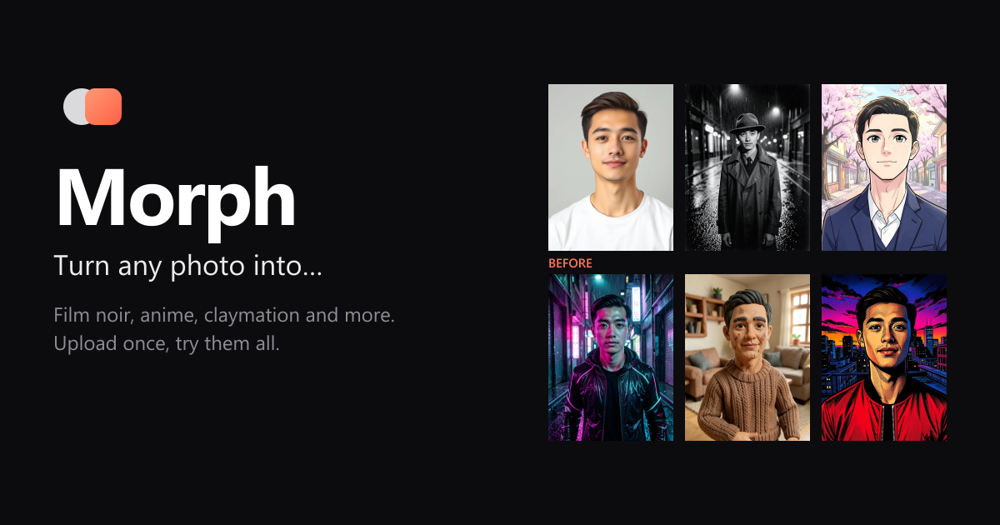

# Morph

**Turn any photo into…** film noir, anime, cyberpunk, claymation and more, in one tap.

Morph is a small AI creative studio: one-tap photo effects, text-to-image with an honest Prompt Assist, reusable characters, and a library with remix and image-to-video. It started as a rebuild of [Higgsfield](https://higgsfield.ai) that fixes the friction I found using it, on a zero budget.

**Live:** _coming soon: add the Vercel URL here_



## Features

- **Effects gallery.** Eight presets with before/after previews. Upload a selfie once and try them all; the photo stays for the session.
- **Guided first run.** A new visitor sees "Start here: upload a selfie and try Film Noir". One upload, one click, first result.
- **Create.** Text-to-image in 1:1, 3:4 or 16:9, with an optional reference image. Ctrl/⌘+Enter to generate.
- **Prompt Assist that never rewrites silently.** "Enhance" shows a suggestion with Use / Edit / Keep original. It reorders your words subject-first, refuses to invent content, and in image mode turns camera language into what a still can show ("drone shot" → "aerial view from above").
- **Visible cost, no paywall.** Every button shows its price ("Generate · 1 credit"). If you can't afford it, it says "Need 5 credits · you have 2" and offers a cheaper option inline. It never redirects you to a pricing page.
- **Characters.** Save a face once (free, 3 per guest session) and pick it on any effect or in Create.
- **Library.** Every job with filters (type, character), a detail view, Remix with the exact settings, Animate (image → video), Download, Use as reference, and lineage ("Animated from →").
- **Live updates.** New jobs appear instantly as shimmering cards, several can run at once, and the credit counter updates in real time.
- **Honest failures.** Errors have specific messages ("The safety filter blocked this result…"), failed jobs are refunded automatically, and demo outputs are labelled.

## Architecture

```
Browser (React + Vite)
   │  POST /api/jobs ──────────────►  Vercel Function
   │                                   1. session cookie + rate limit + validation
   │                                   2. spend_credits()  (atomic, in Postgres)
   │                                   3. insert job (queued) ── 202 Accepted
   │                                   4. waitUntil(runJob):
   │                                        provider adapter ─► Workers AI / mock
   │                                        upload output ─► Supabase Storage
   │                                        job done | failed + refund_credits()
   │
   └─ Supabase Realtime ◄── DB trigger broadcasts every job/credit change
      channel jobs:<realtime_key>         to that session's channel
```

**Provider adapter → job pipeline → realtime broadcast:**

1. **Provider adapter** (`api/_lib/providers/`). Each provider implements one interface, `generate(job) → { buffer, contentType } | { url }`. Today:
   - `cloudflare-image` (FLUX.1 schnell, text → image),
   - `cloudflare-edit` (FLUX.2 klein 4B, image + prompt → image),
   - `mock-video` (sample clips),
   - `mock-image` (the fallback when AI capacity runs out),
   - `prompt-assist` (Llama 3.2 3B).

   `IMAGE_PROVIDER` / `VIDEO_PROVIDER` choose which one runs. Swapping in a paid model only touches one provider file.
2. **Job pipeline** (`api/jobs.ts`, `api/_lib/pipeline.ts`). Credits are spent atomically before the job exists, and the function answers 202 straight away. The work then runs in `waitUntil`. Every failure becomes an error code and a refund. Stuck jobs are swept and refunded. If Workers AI is out of free capacity, the job is served a refunded demo output instead of failing.
3. **Realtime broadcast** (`supabase/pipeline.sql`). A Postgres trigger broadcasts each job and credit change to `jobs:<realtime_key>`, a channel only that session knows. The browser never reads tables directly: every table has row-level security with no policies, and all access goes through the API with the service role.

Production guards (session farming, rate limit, quota fallback, stuck jobs, input validation, error mapping) are described in [DECISIONS.md](DECISIONS.md#guards).

## Why Cloudflare Workers AI (zero budget)

The whole project runs on free tiers: Vercel Hobby, Supabase free, and Cloudflare Workers AI's free daily allocation of 10,000 neurons. That's roughly 90 effects or 170 images a day. Because everything goes through the provider adapter, the cheap choice isn't locked in: a paid model is one new provider file and an env var. When the free allocation runs out, Morph shows a banner and serves refunded demo outputs instead of failing. The reasoning, model tests and numbers are in [DECISIONS.md](DECISIONS.md#zero-budget-cloudflare-workers-ai-behind-a-provider-adapter).

## Run it locally

**Requirements:** Node 24+, a Supabase project, a Cloudflare account with Workers AI, and the Vercel CLI (`npx vercel`).

1. **Install:** `npm install`
2. **Database:** in the Supabase SQL editor, run these files **in order**. Each is safe to re-run.
   1. `supabase/schema.sql`: tables and storage buckets
   2. `supabase/pipeline.sql`: atomic credit functions, row-level security, realtime triggers
   3. `supabase/guards.sql`: session-farming columns, rate-limit counters, flags, refund tracking

   In Project Settings → Realtime, make sure public channels are allowed.
3. **Environment:** create `.env.local`:

   | Variable | What it is |
   |---|---|
   | `VITE_SUPABASE_URL` | Project URL, e.g. `https://<ref>.supabase.co` |
   | `VITE_SUPABASE_ANON_KEY` | Anon/publishable key (used only for Realtime) |
   | `SUPABASE_SERVICE_ROLE_KEY` | Service role key (server only) |
   | `CF_ACCOUNT_ID` | Cloudflare account id |
   | `CF_API_TOKEN` | API token with Workers AI permission |
   | `IMAGE_PROVIDER` | `cloudflare` |
   | `VIDEO_PROVIDER` | `mock` |
   | `IP_HASH_SALT` | Optional. Salt for hashing client IPs (defaults to a server secret) |

   For deployments, add the same variables in the Vercel project settings.
4. **Seed content** (uses a little of the free quota):
   - `node scripts/seed-effects.ts`: the eight effect presets and their previews, made from a fictional portrait
   - `node scripts/seed-demo-images.ts`: sample images for the capacity fallback
   - Upload a few short `.mp4` clips to `outputs/samples/` for the mock video provider (720p, a few MB each, keeps it fast)
5. **Run:** `npx vercel dev`, then open http://localhost:3000. `/dev` is a bare pipeline test page.

Other scripts: `npm run build` (type-checks app and API, then builds), `npm run lint`, `node scripts/make-og.ts` (rebuilds the social image), `node scripts/test-models.ts` / `node scripts/klein-grid.ts` (the model experiments behind the settings).

## More

- [DECISIONS.md](DECISIONS.md): what I found using Higgsfield, what I built and cut, model validation, and every guard with its reasoning.
- [docs/loom/](docs/loom/): Prompt Assist before/after material.
