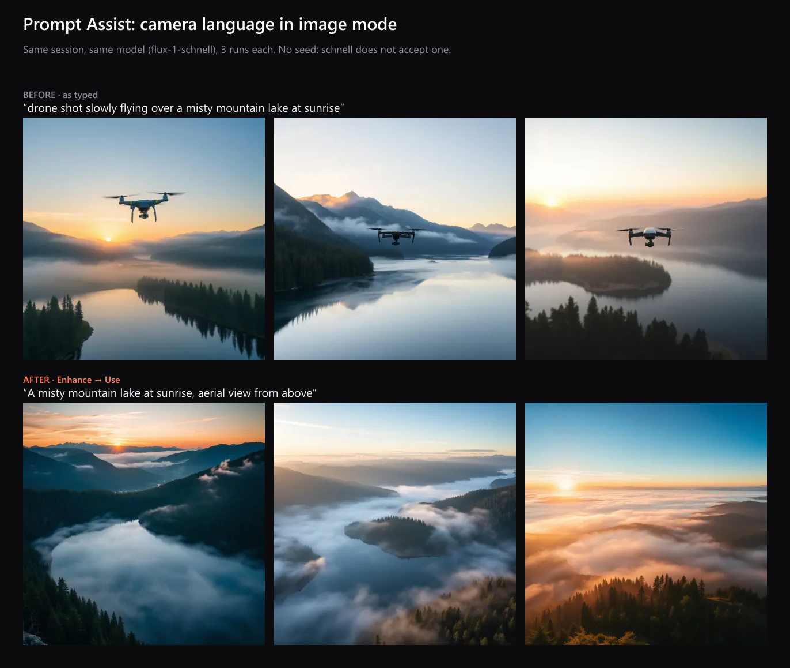

# Loom: Prompt Assist before/after (drone prompt)

Recorded 2026-10-11 through the real `/create` page (headless Chrome against `vercel dev`), image mode, 1:1.

## The prompt

| | Prompt sent to the model |
|---|---|
| **Before** (as typed) | `drone shot slowly flying over a misty mountain lake at sunrise` |
| **After** (Enhance → Use) | `A misty mountain lake at sunrise, aerial view from above` |

Prompt Assist showed the change it made: `"drone shot slowly flying over" → "aerial view from above"`.

## Result

| | Drone visible in the image | Images |
|---|---|---|
| Before | **3 of 3** | `before-1.webp`, `before-2.webp`, `before-3.webp` |
| After | **0 of 3**, all real aerial views of the lake | `after-1.webp`, `after-2.webp`, `after-3.webp` |
| Your earlier runs (before the fix) | 2 of 2 | `original-run-1.jpg`, `original-run-2.webp` |

All six new images came from the same session and the same model (flux-1-schnell, 1 credit each, 2.9–5.3s on the server). schnell doesn't accept a seed, so each run is a fresh sample: the 3-vs-3 is there to show the difference holds across runs, not on one lucky image.

## Why it happened, and the fix

An image model reads "drone shot" as "a drone", so it drew one. Before this fix, Prompt Assist made it worse: it rewrote the prompt as *"Mountain lake at sunrise, a drone is slowly flying over it"*, making the drone the subject.

In image mode, Prompt Assist now rewrites camera language with fixed rules before the language model sees the prompt (`api/_lib/providers/prompt-assist.ts`, `toStill`):

- Viewpoints become what a still image shows, moved after the subject: "drone shot / FPV drone footage" → "aerial view from above", "wide shot" → "wide view", "POV shot" → "first-person view".
- Pure camera movement is dropped: "slow pan", "dolly zoom", "camera pushes in on", "time-lapse of", "slow motion".
- Ordinary words are left alone: "frying pan", "a bird flying over the lake".
- The invented-word check runs against the converted prompt, so the model can't bring "drone" back.
- Video mode keeps camera language, since there it means something.

## UI captures for the walkthrough

1. `ui-1-typed.png`: prompt as typed
2. `ui-2-suggestion.png`: Enhance shows the suggestion and what changed; the textarea still holds your words
3. `ui-3-using.png`: after Use, "Generating with" shows the exact prompt that will be sent
4. `ui-4-results.png`: the feed with all six results (newest first; the top row is the "after" set)

For a live recording, the same steps work in your own browser: type the prompt, Generate, then Enhance → Use → Generate.
